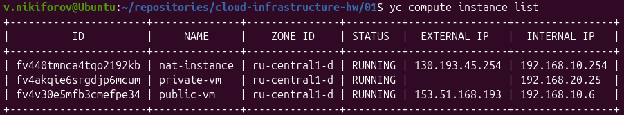
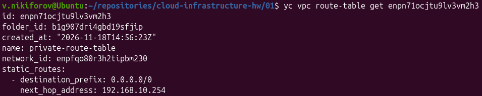
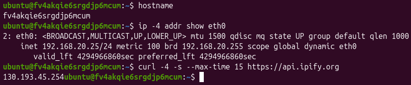

# Домашнее задание «Организация сети»

## Задание 1. Организация сети

С помощью Terraform в Yandex Cloud развёрнута инфраструктура, состоящая из публичной и приватной подсетей, NAT-инстанса и двух виртуальных машин.

### Созданные ресурсы

- VPC: `network-hw`.
- Публичная подсеть: `192.168.10.0/24`.
- Приватная подсеть: `192.168.20.0/24`.
- NAT-инстанс с внутренним IP `192.168.10.254`.
- Публичная виртуальная машина `public-vm`.
- Приватная виртуальная машина `private-vm` без публичного IP.
- Таблица маршрутизации `private-route-table`.

Все ресурсы размещены в зоне `ru-central1-d`.

### Схема сети

```text
                     Internet
                        |
          +-------------+-------------+
          |                           |
     public-vm                   nat-instance
     Public IP                   Public IP
     153.51.168.193              130.193.45.254
     Private IP                  Private IP
     192.168.10.6                192.168.10.254
          |                           |
          +-------------+-------------+
                        |
               Public subnet
              192.168.10.0/24
                        |
                   VPC network
                   network-hw
                        |
               Private subnet
              192.168.20.0/24
                        |
                   private-vm
                  192.168.20.25
                  No public IP
                        |
              Default route via
               192.168.10.254
```

### Terraform

Terraform-конфигурации размещены в общей директории [terraform](../terraform/). Конфигурация разделена на файлы:

- `providers.tf` - провайдер Yandex Cloud.
- `variables.tf` - входные переменные.
- `images.tf` - образы виртуальных машин.
- `main.tf` - VPC и подсети.
- `nat.tf` - NAT-инстанс.
- `instances.tf` - публичная и приватная виртуальные машины.
- `route.tf` - таблица маршрутизации.
- `outputs.tf` - выходные значения.

Для развёртывания используются команды:

```bash
cd terraform
terraform init
terraform validate
terraform plan
terraform apply
```

Значения `cloud_id`, `folder_id` и `zone` задаются через `terraform.tfvars`, который исключён из Git.

Для аутентификации используется IAM-токен Yandex Cloud:

```bash
export YC_TOKEN="$(yc iam create-token)"
```

### Результаты развёртывания

На момент проверки все три виртуальные машины были успешно созданы и находились в состоянии `RUNNING`.



### Настройка маршрутизации

Для приватной подсети создана таблица маршрутизации со статическим маршрутом:

- Destination: `0.0.0.0/0`
- Next hop: `192.168.10.254`

Таким образом, исходящий трафик из приватной подсети направляется через NAT-инстанс.



### Проверка подключения

Подключение к публичной виртуальной машине выполнялось по SSH:

```bash
ssh -i ~/.ssh/id_ed25519 ubuntu@153.51.168.193
```

Подключение к приватной виртуальной машине выполнялось через публичную VM с использованием ProxyJump:

```bash
ssh -i ~/.ssh/id_ed25519 \
  -J ubuntu@153.51.168.193 \
  ubuntu@192.168.20.25
```

Оба подключения успешно выполнены.

### Проверка доступа в интернет через NAT

На приватной виртуальной машине выполнены команды:

```bash
hostname
ip -4 addr show eth0
curl -4 -s --max-time 15 https://api.ipify.org
```

Результат:

```text
Private VM IP: 192.168.20.25
External IP:   130.193.45.254
```

Полученный внешний IP совпадает с публичным IP NAT-инстанса.

Это подтверждает, что приватная виртуальная машина получает доступ в интернет через NAT, не имея собственного публичного IP.



## Итог

С помощью Terraform создана сеть Yandex Cloud с публичной и приватной подсетями.

Проверены:

- Создание всех необходимых ресурсов.
- SSH-доступ к публичной виртуальной машине.
- SSH-доступ к приватной виртуальной машине через ProxyJump.
- Доступ публичной виртуальной машины в интернет.
- Доступ приватной виртуальной машины в интернет через NAT-инстанс.

Все проверки завершились успешно.
