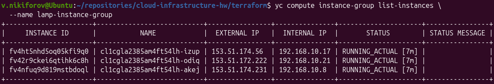
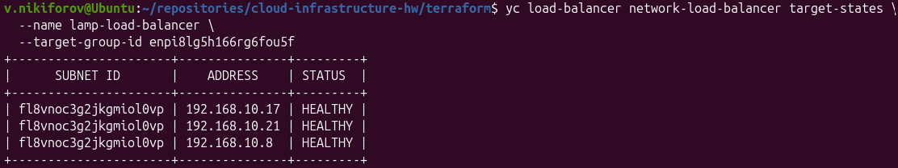
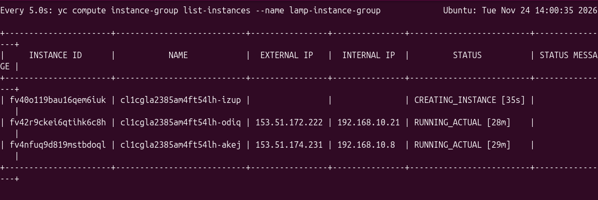
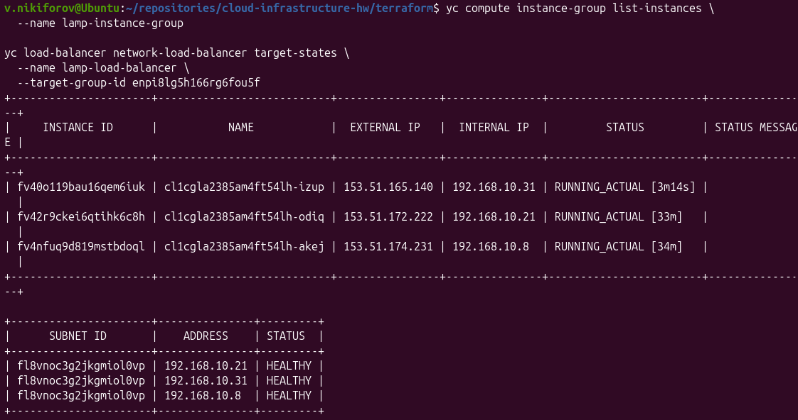
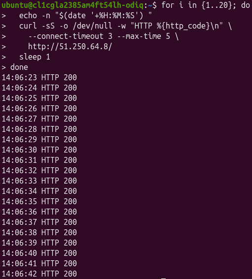

# Домашнее задание «Вычислительные мощности. Балансировщики нагрузки»

## Задание 1. Yandex Cloud

Для выполнения задания использовался Terraform и инфраструктура Yandex Cloud, созданная в рамках предыдущего домашнего задания «Организация сети».

Все Terraform-конфигурации размещены в общей директории [terraform](../terraform/).

## 1. Создание бакета Object Storage

Создан бакет со следующими параметрами:

- Имя: `kefffirchik-cloud-hw-cats-20261118`.
- Объект: `cats.jpg`.
- Тип содержимого: `image/jpeg`.
- Права доступа к объекту: `public-read`.

Terraform-конфигурация: [storage.tf](../terraform/storage.tf).

Изображение доступно по публичной ссылке:

https://storage.yandexcloud.net/kefffirchik-cloud-hw-cats-20261118/cats.jpg

Проверка доступности изображения:

```bash
curl -I https://storage.yandexcloud.net/kefffirchik-cloud-hw-cats-20261118/cats.jpg
```

Получен ответ `HTTP/2 200`, подтверждающий доступность изображения.


## 2. Создание Instance Group

Создана группа виртуальных машин `lamp-instance-group` на базе образа LAMP.

### Параметры группы виртуальных машин

| Параметр | Значение |
|---|---|
| Количество VM | 3 |
| Образ | LAMP |
| ID образа | fd827b91d99psvq5fjit |
| Платформа | standard-v3 |
| vCPU | 2 |
| Гарантированная доля vCPU | 20% |
| RAM | 2 ГБ |
| Диск | HDD, 10 ГБ |
| Зона доступности | ru-central1-d |
| Сеть | network-hw |
| Подсеть | public |
| CIDR | 192.168.10.0/24 |
| Публичные IP-адреса | Да |
| Политика масштабирования | Fixed Scale |
| Health Check | HTTP, порт 80, путь / |

Terraform-конфигурация: [instance-group.tf](../terraform/instance-group.tf).

### Настройка стартовой веб-страницы

С помощью metadata и cloud-init на каждой виртуальной машине автоматически создаётся файл `/var/www/html/index.html`, содержащий заголовок и ссылку на изображение из Object Storage.

После создания файла выполняется перезапуск веб-сервера Apache.

Таким образом, каждая виртуальная машина автоматически получает одинаковую стартовую веб-страницу.

### Проверка состояния Instance Group

```bash
yc compute instance-group list-instances \
  --name lamp-instance-group
```

Все три виртуальные машины успешно созданы и находятся в статусе `RUNNING_ACTUAL`.



### Проверка доступности веб-серверов

Выполнена проверка доступности каждой виртуальной машины по её публичному IP-адресу.

Первая виртуальная машина - `153.51.174.56`:


Вторая виртуальная машина - `153.51.172.222`:


Третья виртуальная машина - `153.51.174.231`:


Дополнительно выполнена проверка HTTP-доступности виртуальных машин:

```bash
for ip in 153.51.174.56 153.51.172.222 153.51.174.231; do
  echo "=== $ip ==="
  curl -v --connect-timeout 5 --max-time 10 "http://$ip/" -o /dev/null
  echo
done
```

Все три веб-сервера возвращают `HTTP 200 OK`.

Стартовая веб-страница и изображение из Object Storage корректно отображаются на каждой виртуальной машине.

## 3. Создание Network Load Balancer

Создан сетевой балансировщик нагрузки, распределяющий входящий трафик между виртуальными машинами Instance Group.

### Параметры балансировщика

| Параметр | Значение |
|---|---|
| Имя | lamp-load-balancer |
| Тип | EXTERNAL |
| Публичный IP | 51.250.64.8 |
| Протокол | TCP |
| Порт балансировщика | 80 |
| Порт целевых VM | 80 |
| Целевая группа | lamp-target-group |
| Health Check | HTTP |
| Путь проверки | / |
| Интервал проверки | 10 секунд |
| Тайм-аут проверки | 5 секунд |
| Healthy threshold | 2 |
| Unhealthy threshold | 3 |

Terraform-конфигурация: [load-balancer.tf](../terraform/load-balancer.tf).

### Проверка состояния балансировщика

```bash
yc load-balancer network-load-balancer list
```

Балансировщик успешно создан и находится в статусе `ACTIVE`.

Получение подробной информации о балансировщике:

```bash
yc load-balancer network-load-balancer get \
  --name lamp-load-balancer
```

Проверка состояния целевой группы:

```bash
yc load-balancer network-load-balancer target-states \
  --name lamp-load-balancer \
  --target-group-id enpi8lg5h166rg6fou5f
```

Все три виртуальные машины успешно проходят проверки работоспособности и находятся в статусе `HEALTHY`.



### Проверка доступности веб-страницы через балансировщик

Веб-страница доступна по публичному IP-адресу балансировщика:

http://51.250.64.8/

При обращении к балансировщику отображается стартовая веб-страница с изображением из Object Storage.


## 4. Проверка отказоустойчивости

Для проверки механизма автоматического восстановления Instance Group выполнено удаление одной виртуальной машины.

Перед удалением проверено текущее состояние группы:

```bash
yc compute instance-group list-instances \
  --name lamp-instance-group
```

Удалена виртуальная машина с идентификатором `fv4ht5nhd5oq05kfi9q0`:

```bash
yc compute instance delete fv4ht5nhd5oq05kfi9q0
```

Для наблюдения за процессом восстановления использована команда:

```bash
watch -n 5 'yc compute instance-group list-instances --name lamp-instance-group'
```

Instance Group автоматически обнаружила отсутствие виртуальной машины и начала создание нового экземпляра.



Новая виртуальная машина последовательно прошла следующие состояния:

- `CREATING_INSTANCE` - создание виртуальной машины.
- `CHECKING_HEALTH` - проверка работоспособности.
- `RUNNING_ACTUAL` - виртуальная машина успешно запущена.

### Результат автоматического восстановления

| Параметр | Удалённая VM | Новая VM |
|---|---|---|
| Instance ID | fv4ht5nhd5oq05kfi9q0 | fv40o119bau16qem6iuk |
| Внутренний IP | 192.168.10.17 | 192.168.10.31 |
| Внешний IP | 153.51.174.56 | 153.51.165.140 |

После завершения восстановления выполнена проверка состояния Instance Group:

```bash
yc compute instance-group list-instances \
  --name lamp-instance-group
```

Проверено состояние целей балансировщика:

```bash
yc load-balancer network-load-balancer target-states \
  --name lamp-load-balancer \
  --target-group-id enpi8lg5h166rg6fou5f
```

Количество виртуальных машин автоматически восстановилось до трёх.

Все виртуальные машины находятся в статусе `RUNNING_ACTUAL`, а все цели балансировщика - в статусе `HEALTHY`.



### Проверка работоспособности балансировщика после восстановления

Для проверки доступности веб-страницы после восстановления Instance Group выполнено подключение к одной из виртуальных машин:

```bash
ssh ubuntu@153.51.172.222
```

На виртуальной машине выполнена серия HTTP-запросов к публичному IP-адресу балансировщика:

```bash
for i in {1..20}; do
  echo -n "$(date '+%H:%M:%S') "
  curl -sS -o /dev/null -w "HTTP %{http_code}\n" \
    --connect-timeout 3 --max-time 5 \
    http://51.250.64.8/
  sleep 1
done
```

В ходе проверки получены последовательные успешные ответы `HTTP 200`.



Автоматическое восстановление Instance Group и работоспособность балансировщика после удаления и замены виртуальной машины подтверждены.

Непрерывная доступность веб-страницы на протяжении всего процесса восстановления не подтверждена.

## 5. Terraform-конфигурации

Все конфигурации размещены в общей директории [terraform](../terraform/).

| Файл | Назначение |
|---|---|
| [providers.tf](../terraform/providers.tf) | Настройка Terraform и провайдера Yandex Cloud |
| [variables.tf](../terraform/variables.tf) | Входные переменные |
| [images.tf](../terraform/images.tf) | Образы виртуальных машин |
| [main.tf](../terraform/main.tf) | VPC и подсети |
| [nat.tf](../terraform/nat.tf) | NAT-инстанс |
| [instances.tf](../terraform/instances.tf) | Публичная и приватная виртуальные машины |
| [route.tf](../terraform/route.tf) | Таблица маршрутизации |
| [outputs.tf](../terraform/outputs.tf) | Выходные значения |
| [storage.tf](../terraform/storage.tf) | Object Storage и загрузка изображения |
| [instance-group.tf](../terraform/instance-group.tf) | Группа виртуальных машин |
| [load-balancer.tf](../terraform/load-balancer.tf) | Сетевой балансировщик нагрузки |

Для развёртывания инфраструктуры использованы команды:

```bash
cd terraform
terraform init
terraform fmt
terraform validate
terraform plan
terraform apply
```

Файлы Terraform State, локальные переменные и служебные файлы Terraform исключены из Git с помощью [.gitignore](../.gitignore).

## Итог

В ходе выполнения задания:

- Создан бакет Object Storage.
- Загружено изображение с публичным доступом.
- Создана Instance Group из трёх виртуальных машин на базе LAMP.
- Настроено автоматическое создание стартовой веб-страницы через metadata и cloud-init.
- Настроены проверки работоспособности виртуальных машин.
- Создан Network Load Balancer.
- Подтверждена доступность веб-страницы через балансировщик.
- Выполнено удаление одной виртуальной машины.
- Подтверждено автоматическое восстановление Instance Group.
- Подтверждена работоспособность балансировщика после восстановления группы.

Все ресурсы созданы с использованием Terraform.
