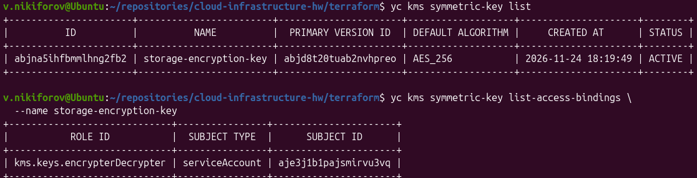
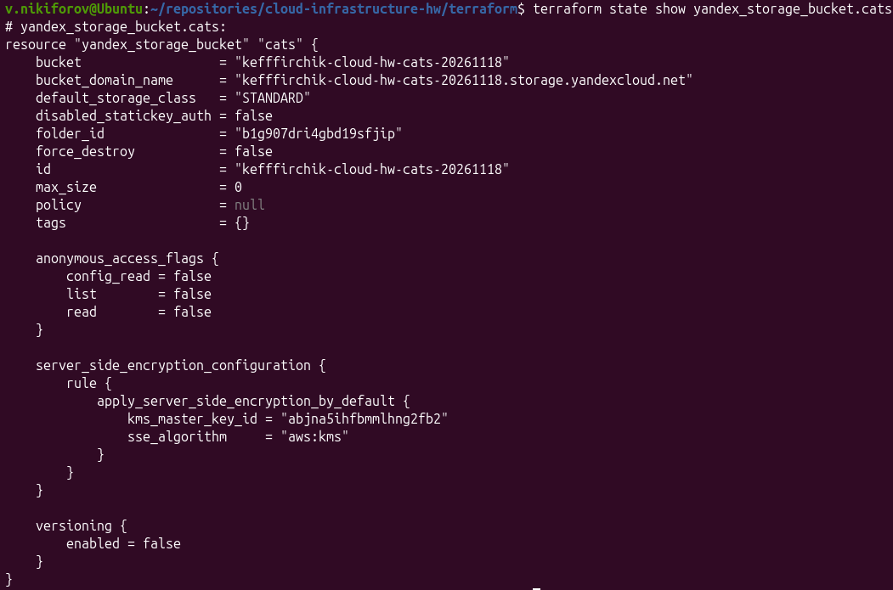
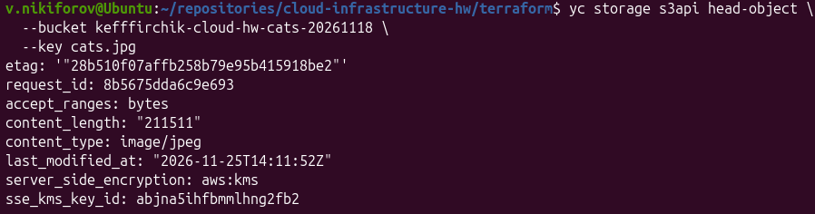

# Домашнее задание «Безопасность в облачных провайдерах»

## Задание 1. Yandex Cloud

Для выполнения задания использовалась инфраструктура Yandex Cloud, созданная в рамках предыдущих домашних заданий.

Все изменения инфраструктуры выполнены с помощью Terraform. Для проверки результатов использовался Yandex Cloud CLI.

Terraform-конфигурации размещены в общей директории [terraform](../terraform/).

## 1. Создание ключа KMS

Для шифрования содержимого существующего бакета Object Storage создан симметричный ключ KMS.

Terraform-конфигурация: [kms.tf](../terraform/kms.tf).

### Параметры ключа

| Параметр | Значение |
|---|---|
| Имя | storage-encryption-key |
| ID ключа | abjna5ihfbmmlhng2fb2 |
| Тип ключа | Симметричный |
| Алгоритм шифрования | AES_256 |
| Период ротации | 8760 часов (365 дней) |
| Статус | ACTIVE |

Для сервисного аккаунта `terraform-sa` назначена роль `kms.keys.encrypterDecrypter`, предоставляющая права на шифрование и расшифровку данных с использованием ключа KMS.

### Создание ресурсов

```bash
terraform fmt
terraform validate

terraform plan \
  -target=yandex_kms_symmetric_key.storage \
  -target=yandex_kms_symmetric_key_iam_binding.storage

terraform apply \
  -target=yandex_kms_symmetric_key.storage \
  -target=yandex_kms_symmetric_key_iam_binding.storage
```

Результат применения конфигурации:

```text
Apply complete! Resources: 2 added, 0 changed, 0 destroyed.
```

### Проверка ключа и прав доступа

```bash
yc kms symmetric-key list

yc kms symmetric-key list-access-bindings \
  --name storage-encryption-key
```

Ключ успешно создан и находится в статусе `ACTIVE`.

Сервисному аккаунту назначена роль `kms.keys.encrypterDecrypter`.



## 2. Настройка шифрования бакета Object Storage

Для шифрования использован бакет `kefffirchik-cloud-hw-cats-20261118`, созданный в рамках предыдущего домашнего задания.

В существующую Terraform-конфигурацию добавлен блок серверного шифрования SSE-KMS:

```hcl
server_side_encryption_configuration {
  rule {
    apply_server_side_encryption_by_default {
      kms_master_key_id = yandex_kms_symmetric_key.storage.id
      sse_algorithm     = "aws:kms"
    }
  }
}
```

Также добавлена зависимость от ресурса назначения прав доступа к ключу KMS:

```hcl
depends_on = [
  yandex_kms_symmetric_key_iam_binding.storage
]
```

Terraform-конфигурация: [storage.tf](../terraform/storage.tf).

### Применение настроек шифрования

```bash
terraform fmt
terraform validate

terraform plan -target=yandex_storage_bucket.cats

terraform apply -target=yandex_storage_bucket.cats
```

План Terraform:

```text
Plan: 0 to add, 1 to change, 0 to destroy.
```

Настройки существующего бакета обновлены без его пересоздания.

### Проверка настроек шифрования

```bash
terraform state show yandex_storage_bucket.cats
```

В Terraform State присутствует конфигурация серверного шифрования:

```hcl
server_side_encryption_configuration {
  rule {
    apply_server_side_encryption_by_default {
      kms_master_key_id = "abjna5ihfbmmlhng2fb2"
      sse_algorithm     = "aws:kms"
    }
  }
}
```



## 3. Шифрование существующего объекта

Изображение `cats.jpg` было загружено в бакет до включения серверного шифрования.

Настройка шифрования по умолчанию применяется к вновь загружаемым объектам и не шифрует автоматически ранее загруженные данные.

Для шифрования существующего изображения выполнена его повторная загрузка через Terraform с использованием параметра `-replace`.

### Повторная загрузка объекта

```bash
terraform plan \
  -target=yandex_storage_object.cats_image \
  -replace=yandex_storage_object.cats_image
```

Результат планирования:

```text
Plan: 1 to add, 0 to change, 1 to destroy.
```

Применение конфигурации:

```bash
terraform apply \
  -target=yandex_storage_object.cats_image \
  -replace=yandex_storage_object.cats_image
```

Результат:

```text
Apply complete! Resources: 1 added, 0 changed, 1 destroyed.
```

Изображение повторно загружено из локального файла [cats.jpg](../02/img/cats.jpg).

При загрузке объекта автоматически применено серверное шифрование с использованием созданного ключа KMS.

Бакет и остальные ресурсы инфраструктуры не пересоздавались.

## 4. Проверка шифрования объекта

Для проверки фактического шифрования изображения использована команда Yandex Cloud CLI:

```bash
yc storage s3api head-object \
  --bucket kefffirchik-cloud-hw-cats-20261118 \
  --key cats.jpg
```

В метаданных объекта получены следующие параметры:

```yaml
content_length: "211511"
content_type: image/jpeg
last_modified_at: "2026-11-25T14:11:52Z"
server_side_encryption: aws:kms
sse_kms_key_id: abjna5ihfbmmlhng2fb2
```

### Результаты проверки

| Параметр | Значение |
|---|---|
| Объект | cats.jpg |
| Размер | 211511 байт |
| Тип содержимого | image/jpeg |
| Серверное шифрование | aws:kms |
| ID ключа KMS | abjna5ihfbmmlhng2fb2 |

Идентификатор ключа в метаданных объекта совпадает с идентификатором ключа KMS, созданного через Terraform.



Таким образом, фактическое шифрование содержимого бакета подтверждено.

## 5. Terraform-конфигурации

В рамках выполнения задания созданы и изменены следующие файлы:

| Файл | Назначение |
|---|---|
| [kms.tf](../terraform/kms.tf) | Создание симметричного ключа KMS и назначение прав доступа |
| [storage.tf](../terraform/storage.tf) | Настройка серверного шифрования бакета Object Storage |

Использована существующая инфраструктура и единый Terraform State предыдущих домашних заданий.

Для внесения изменений применялось целевое управление ресурсами Terraform с параметром `-target`, чтобы не затрагивать остановленные виртуальные машины, Instance Group и Network Load Balancer.

Файлы Terraform State, локальные переменные и служебные файлы Terraform исключены из Git с помощью [.gitignore](../.gitignore).

## Итог

В ходе выполнения задания:

- Создан симметричный ключ KMS с алгоритмом AES-256.
- Настроена автоматическая ротация ключа.
- Назначены необходимые права сервисному аккаунту.
- Настроено серверное шифрование существующего бакета Object Storage.
- Выполнена повторная загрузка ранее созданного объекта.
- Подтверждено фактическое шифрование объекта с использованием созданного ключа KMS.
- Сохранена инфраструктура предыдущих домашних заданий.

Все изменения инфраструктуры выполнены с использованием Terraform.

Обязательная часть задания выполнена.
