# Домашнее задание «Кластеры. Ресурсы под управлением облачных провайдеров»

## Задание 1. Создание кластера MySQL

Для выполнения задания использовалась инфраструктура Yandex Cloud, созданная в рамках предыдущих домашних заданий.

Все новые облачные ресурсы созданы с помощью Terraform.

### 1.1. Настройка сети

В существующей сети `network-hw` созданы дополнительные подсети.

Итоговая конфигурация сети:

| Подсеть | Зона доступности | CIDR |
|---|---|---|
| public | ru-central1-d | 192.168.10.0/24 |
| public-a | ru-central1-a | 192.168.11.0/24 |
| public-e | ru-central1-e | 192.168.12.0/24 |
| private | ru-central1-d | 192.168.20.0/24 |
| private-a | ru-central1-a | 192.168.21.0/24 |

Для размещения хостов MySQL используются приватные подсети в двух разных зонах доступности.

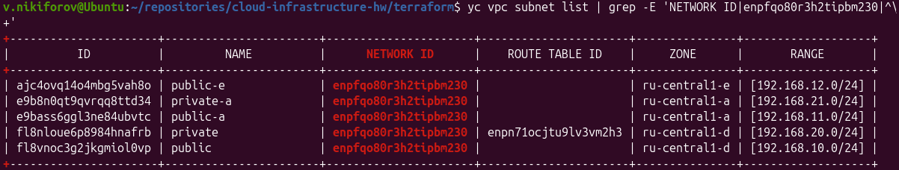

Конфигурация Terraform: [main.tf](../terraform/main.tf).

### 1.2. Создание кластера MySQL

Создан отказоустойчивый кластер `netology-mysql` со следующими параметрами:

| Параметр | Значение |
|---|---|
| Версия MySQL | 8.0 |
| Окружение | PRESTABLE |
| Класс ресурсов | s2.micro |
| vCPU на хост | 2 |
| RAM на хост | 8 ГБ |
| Гарантированная доля CPU | 100% |
| Тип диска | network-ssd |
| Размер диска | 20 ГБ |
| Количество хостов | 2 |
| Зоны доступности | ru-central1-a, ru-central1-d |
| Окно технического обслуживания | ANYTIME |
| Начало резервного копирования | 23:59 UTC |
| Защита от удаления | Включена |
| Публичный доступ к хостам | Отключён |

Вместо указанного в задании класса Intel Broadwell с гарантированной долей CPU 50% использован класс `s2.micro` в связи с ограничениями доступности требуемого класса ресурсов в выбранных зонах доступности.

Документация: [Классы хостов Managed Service for MySQL](https://yandex.cloud/ru/docs/managed-mysql/concepts/instance-types).

Кластер успешно создан и находится в состоянии RUNNING, статус здоровья — ALIVE.

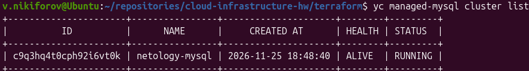

### 1.3. Настройка репликации

Хосты MySQL размещены в разных зонах доступности:

- ru-central1-a - MASTER;
- ru-central1-d - REPLICA.

Оба хоста находятся в состоянии ALIVE.

Отказоустойчивая конфигурация и репликация обеспечиваются сервисом Yandex Managed Service for MySQL.

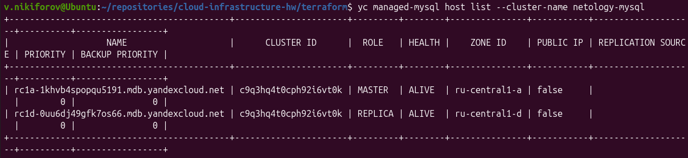

Проверены параметры кластера, окно технического обслуживания, время начала резервного копирования и защита от удаления.

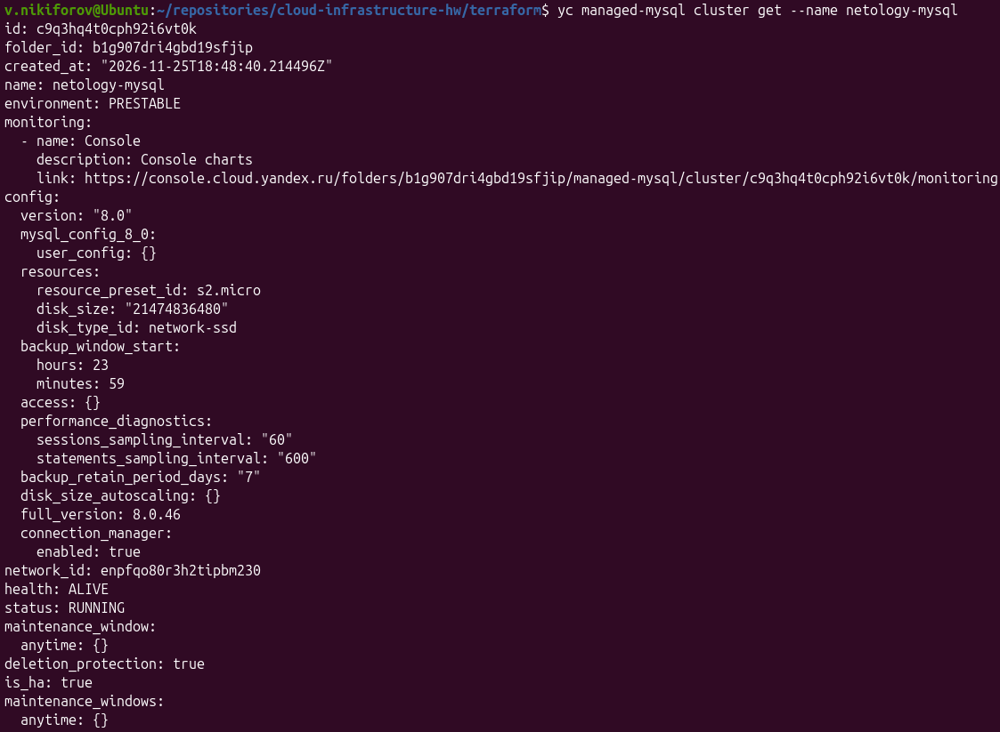

### 1.4. Создание базы данных и пользователя

С помощью Terraform созданы:

- база данных `netology_db`;
- пользователь `netology_user`;
- права пользователя на базу данных - ALL.

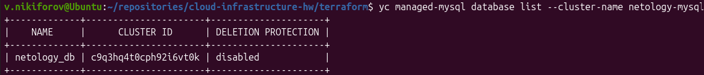

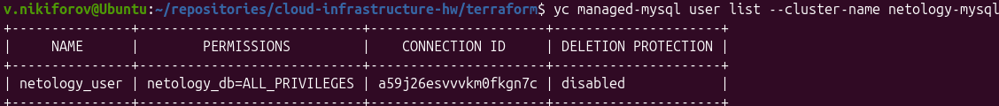

Пароль пользователя передаётся через чувствительную переменную Terraform `mysql_password`.

Файл `terraform.tfvars`, содержащий пароль, исключён из системы контроля версий с помощью `.gitignore`.

Конфигурация Terraform:

- [mysql.tf](../terraform/mysql.tf);
- [variables.tf](../terraform/variables.tf).

---

## Задание 2. Создание кластера Kubernetes

### 2.1. Настройка сети

Для размещения регионального мастера Kubernetes используются три публичные подсети в разных зонах доступности:

| Подсеть | Зона доступности | CIDR |
|---|---|---|
| public-a | ru-central1-a | 192.168.11.0/24 |
| public | ru-central1-d | 192.168.10.0/24 |
| public-e | ru-central1-e | 192.168.12.0/24 |

Подсети `public-a` и `public-e` созданы дополнительно с помощью Terraform.

### 2.2. Создание сервисного аккаунта

Создан отдельный сервисный аккаунт `netology-k8s-sa` для Managed Service for Kubernetes.

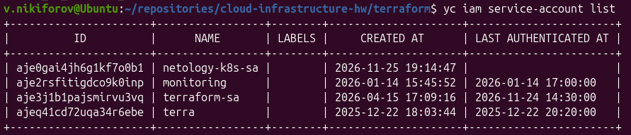

Сервисному аккаунту назначены следующие роли:

| Роль | Назначение |
|---|---|
| k8s.clusters.agent | Управление ресурсами кластера Kubernetes |
| vpc.publicAdmin | Управление публичными IP-адресами |
| container-registry.images.puller | Загрузка образов из Container Registry |

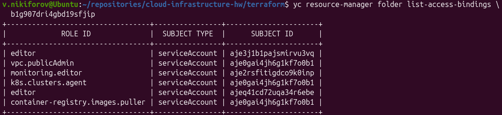

Конфигурация Terraform: [iam.tf](../terraform/iam.tf).

### 2.3. Настройка шифрования с использованием KMS

Для шифрования секретов Kubernetes использован ключ `storage-encryption-key`, созданный в рамках предыдущего домашнего задания.

Сервисному аккаунту Kubernetes предоставлена роль `kms.keys.encrypterDecrypter` на существующий ключ.

Права ранее созданного сервисного аккаунта сохранены.

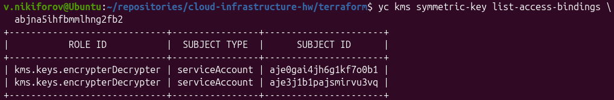

Конфигурация Terraform: [kms.tf](../terraform/kms.tf).

### 2.4. Создание регионального кластера Kubernetes

Создан кластер `netology-k8s` со следующими параметрами:

| Параметр | Значение |
|---|---|
| Версия Kubernetes | 1.35 |
| Тип мастера | Региональный |
| Регион | ru-central1 |
| Зоны доступности мастера | ru-central1-a, ru-central1-d, ru-central1-e |
| Количество узлов etcd | 3 |
| Канал обновлений | STABLE |
| Публичный доступ к API | Включён |
| Сервисный аккаунт | netology-k8s-sa |
| CIDR подов | 10.112.0.0/16 |
| CIDR сервисов | 10.96.0.0/16 |
| Шифрование секретов | Yandex KMS |
| Ключ шифрования | storage-encryption-key |

Кластер успешно создан и находится в состоянии RUNNING, статус здоровья - HEALTHY.

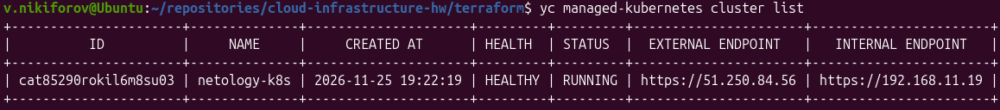

Проверена конфигурация регионального мастера, размещение в трёх зонах доступности и использование ключа KMS.

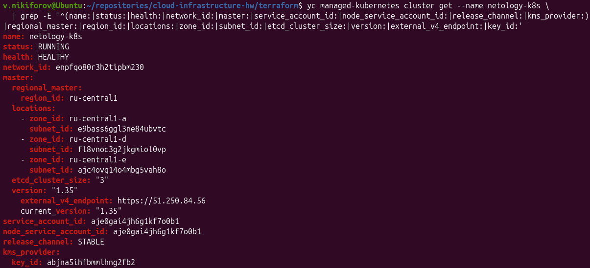

### 2.5. Создание группы рабочих узлов

Создана группа рабочих узлов `netology-workers` с автоматическим масштабированием.

Параметры группы:

| Параметр | Значение |
|---|---|
| Версия Kubernetes | 1.35 |
| Платформа | standard-v3 |
| vCPU на узел | 2 |
| RAM на узел | 4 ГБ |
| Гарантированная доля CPU | 100% |
| Тип диска | network-hdd |
| Размер диска | 30 ГБ |
| Среда выполнения контейнеров | containerd |
| Зона доступности | ru-central1-a |
| Начальное количество узлов | 3 |
| Минимальное количество узлов | 3 |
| Максимальное количество узлов | 6 |
| Тип масштабирования | Автоматическое |

Группа рабочих узлов размещена в одной зоне доступности, при этом региональный мастер распределён по трём зонам доступности.

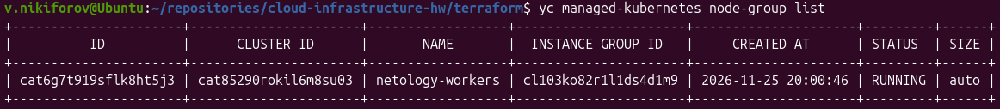

Проверены параметры автоматического масштабирования.

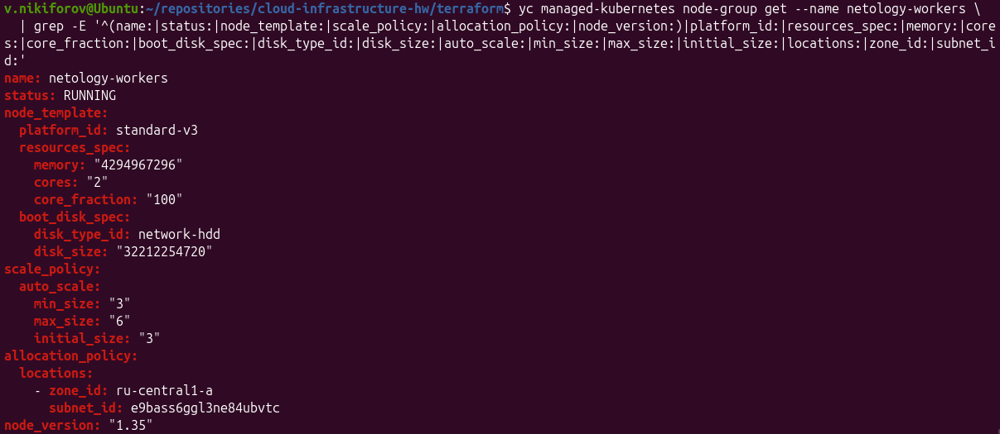

Все три рабочих узла успешно созданы и находятся в состоянии READY.

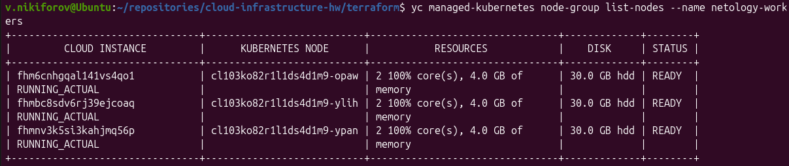

Конфигурация Terraform: [kubernetes.tf](../terraform/kubernetes.tf).

### 2.6. Подключение к кластеру через kubectl

Для подключения к кластеру получена конфигурация kubeconfig с помощью Yandex Cloud CLI:

```bash
yc managed-kubernetes cluster get-credentials \
  --name netology-k8s \
  --external
```

В результате создан контекст `yc-netology-k8s`.

Из-за сетевых тайм-аутов при подключении к публичному API Kubernetes из локальной Ubuntu итоговая проверка выполнена через Yandex Cloud Shell.

Для проверки состояния рабочих узлов выполнена команда:

```bash
kubectl get nodes -o wide
```

Все три рабочих узла находятся в состоянии Ready.

Версия Kubernetes на рабочих узлах - v1.35.1.

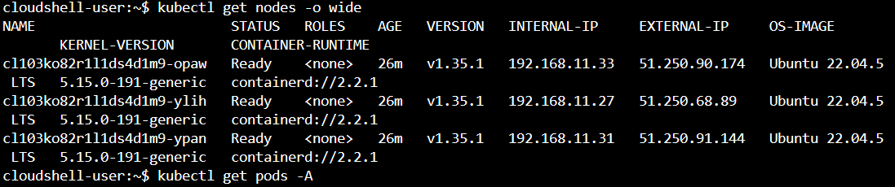

Дополнительно проверено состояние системных подов:

```bash
kubectl get pods -A
```

Все 17 системных подов находятся в состоянии Running, перезапуски контейнеров отсутствуют.

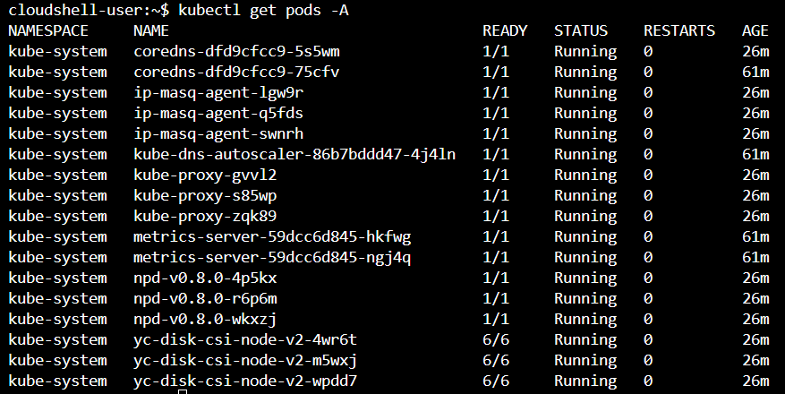

Подключение к кластеру через kubectl успешно выполнено.

---

## Итог

В рамках домашнего задания:

- расширена существующая сеть Yandex Cloud;
- создан отказоустойчивый кластер MySQL с репликацией;
- настроены резервное копирование и защита от удаления кластера MySQL;
- созданы база данных и пользователь MySQL;
- создан отдельный сервисный аккаунт Kubernetes с необходимыми ролями;
- настроено шифрование секретов Kubernetes с использованием существующего ключа KMS;
- создан региональный мастер Kubernetes в трёх зонах доступности;
- создана группа из трёх рабочих узлов с автоматическим масштабированием до шести;
- выполнено подключение к кластеру через kubectl;
- подтверждена работоспособность рабочих узлов и системных подов Kubernetes.

Все облачные ресурсы в рамках задания созданы с помощью Terraform.

## Исходный код

Все Terraform-конфигурации находятся в каталоге [terraform](../terraform/).
